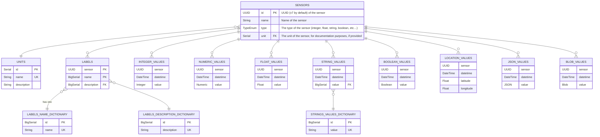

# SensApp Data Model

The SensAPP data model is inspired by the [SenML proposed standard](https://www.rfc-editor.org/rfc/rfc8428), the [Prometheus remote write](https://prometheus.io/docs/concepts/remote_write_spec/) and [remote read](https://github.com/prometheus/prometheus/blob/main/prompb/types.proto) data models, the [InfluxDB line protocol](https://docs.influxdata.com/influxdb/cloud/reference/syntax/line-protocol/), the [OpenMetrics](https://openmetrics.io) proposed standard, and [ThingModel](https://github.com/SINTEF-9012/ThingModel).

A sensor has a unique name used to identify it.

Each sensor contains only one type of data. If your sensor measures more than one thing, like temperature and humidity, it should be represented as two sensors in SensApp.

Sensors can have labels attached to them, which are key-value pairs. Those are not tracked over time. They are used to add metadata to the sensors. If you wish to track labels, you should create a sensor for each label and use the sensor value to store the label value.

Labels are part of the identity of a sensor. The UUID that SensApp derives from a name, a type, a unit and labels covers them, so a Prometheus or InfluxDB series whose label changes is another sensor, with its own history. The labels of a sensor are written when it is created and never updated: publishing again a UUID that exists, which only a client that chooses its own UUIDs can do (an Arrow stream, SenML), adds the samples and keeps the labels it was created with. This is the same on every backend.

A label name given twice to one series (`cpu,host=a,host=b` in InfluxDB line protocol) is refused with `400`: there would be no telling which value is the label.

A write that names a UUID that exists must give the stored **type** of that sensor. Otherwise the whole request is refused with `409 Conflict`: the type chooses where the samples are stored, and samples of another type would land in a table no read of the series looks at. The name, the unit and the labels are not compared: the write appends, and the name, the unit and the labels the sensor was created with stay (an import may leave them out, and a SenML record without `_name` or an Arrow upload with only `sensor_id` is the series of its UUID, whatever its name). Who may write to which series is decided by the token, see [JWT_AUTH.md](JWT_AUTH.md#security-notes). One request that gives one UUID two types is refused; with two names, the series is created under the first. A name, a unit or a label with a NUL or a separator byte is a `400` for a series that names its UUID too. ClickHouse and BigQuery have no transactions: two requests that create one new UUID with two identities at the same moment are not caught (measured on ClickHouse: both writers succeed).

ClickHouse and BigQuery key a series by 64 bits of a hash of its UUID (the first 8 bytes of its BLAKE3 hash, keyed by `SENSAPP_SENSOR_SALT`). A hash and not the UUID's own bits, because SenML and Arrow writers may choose UUIDs with a structure, two numbers in the two halves for instance, and the structure must not make keys collide. Keyed, so that nobody who does not know the salt can look for two UUIDs of the same key offline (about 2^32 hashes): set your own salt, the default one is public. **Changing the salt changes every key** and orphans the stored series of these two backends. Two UUIDs can still have the same key, by chance at billions of series or on purpose: a new UUID whose key is the key of another stored sensor, or of another sensor of the same request, is refused with `409 Conflict`: use another UUID. The check is a read before the write, so two instances that register two colliding UUIDs at the same instant both pass it: on ClickHouse the `ReplacingMergeTree` later keeps one `sensors` row, which then owns the samples of both, and on BigQuery both rows stay and a read picks one. Only a writer that chooses colliding UUIDs, with the public default salt, can make that happen: set your own salt. The other backends key series by the whole UUID.

**A database must not change its keys under the data.** At startup, ClickHouse and BigQuery read ten stored sensors and refuse to start when one is stored under another key than this version and this `SENSAPP_SENSOR_SALT` give it (a database written before the hash, or with another salt): writing into it would register every stored UUID a second time, and the reads by UUID would only find the new samples. Empty the database, or set the salt back.

An Arrow upload whose `sensapp.sensor.type` metadata is not the type of its `value` column is refused with `400`, except a text column declared `json`, which is how the Arrow export writes JSON series: its values are parsed as JSON.

An Arrow batch holds the samples of one sensor: a `sensor_id` or `sensor_name` column must hold the same value on every row (text, or a dictionary of text), and a column that names two sensors, or has a null, is refused with `400`. Send one batch per sensor. A null timestamp is refused with `400`. A null value is no sample: the row is dropped (a location with a null latitude or longitude too), and a batch of only null values stores nothing.

SensApp distinguises between:

 - **Integer** values, which are 64 bits integers.
 - **Float** values, which are IEEE 754 64 bits floating point numbers. Those are **approximates** values, check the section about floating point numbers for more information. See [Non-finite floats](#non-finite-floats) for NaN and the infinities.
 - **Numeric** values, which are decimal numbers, that shouldn't be approximate values. In memory they are `rust_decimal::Decimal`: 96 bits of digits (about 28) and up to 28 digits after the point. A value or an Arrow decimal outside that range is refused with an error. SQLite stores them as text, normalised (`1.00` is stored as `1`, so that it is a duplicate of `1`). ClickHouse stores them as `Decimal(38, 8)`, DuckDB as `DECIMAL(38, 9)` and BigQuery as `NUMERIC`: 8, 9 and 9 digits after the point, more are rounded, and every value of a `Decimal` fits. See [Aggregating Numeric values](#aggregating-numeric-values).
 - **String** values, which are UTF-8 encoded strings.
 - **Boolean** values, which are true or false.
 - **Locations** values, which are latitude and longitude coordinates, with an optional altitude. We consider earth as the center of the universe. _Do not_ use this type for space projects, and rely on multiple sensors instead.
 - **JSON** values, which are JSON objects. This not a recommended type but it can be very convenient to store complex data.

## Label Selectors

Selectors (`/api/v1/query`, `/series?selector=`, `/prometheus/metrics?selector=`, Prometheus remote read) use the Prometheus operators `=`, `!=`, `=~` and `!~` on labels, and on the metric name with `__name__`. A metric name in front of the braces is the same as `__name__="name"`: `temperature{room="a"}` selects the series named `temperature` whose `room` is `a`. A regex that is not RE2, or that a backend would read otherwise, is refused with `400`. **The accepted subset** is what RE2, the `regex` crate and PostgreSQL read the same way: literals, `.`, `|`, `(...)` and `(?:...)`, the leading flags `(?i)` and `(?s)`, the classes `\d \D \s \S \w \W`, the escapes `\A \n \t \r \f \v \a` and escaped punctuation, `* + ?` and `{m}`, `{m,}`, `{m,n}` with bounds up to 255 (and a lazy `?` after them), character classes with ranges and POSIX classes such as `[[:digit:]]`. Refused are back-references, lookarounds, named groups, other flags, word boundaries, `\u`, `\x`, `\p`, a `[` inside a class, the class operations `&&`, `--`, `~~`, negated POSIX classes, bounds above 255, and a repetition of a repetition or of an assertion (`a**`, `^*`). The answer names the construct. One difference stays: `\d`, `\w` and `\s` are Unicode-aware on SQLite, RRDcached and in the in-memory matching of `/series?selector=` (the `regex` crate) and ASCII-only on the RE2 backends, so `{room=~"\w+"}` can match `café` on one and not on the other. Use an explicit class (`[a-zA-Z0-9_]`) when it matters. The refused modifiers are the `offset` and `@` modifiers, which SensApp does not implement.

A series written by Prometheus remote write is named after its `__name__` label, which is not stored among its labels, and the reads add it back. Its `unit` label is both a label and the unit of the series.

A regular expression matches the **whole** value, as in Prometheus: `region=~"eu"` selects the series whose region is exactly `eu`, not `eu-west` nor `europe`. Use `eu.*` for a prefix, `.*west.*` for a part, and `eu|us` for alternatives (the alternation is anchored as a whole). SensApp anchors the pattern as `^(?:pattern)$` when it reads the selector, so every backend behaves the same. Case-insensitive matching works with a leading flag, `region=~"(?i)EU.*"`.

### Known differences from Prometheus

In Prometheus a series without a label behaves as if the label were the empty string. SensApp does not do that for the matchers that select series: a series without the label is only selected by the negative operators `!=` and `!~` (which is the Prometheus result when the value is not empty). Checked on SQLite; the other SQL backends use the same query shape. For a label `zone` that some series lack:

| Selector | In Prometheus | In SensApp |
| --- | --- | --- |
| `zone=""` | the series without `zone` | nothing |
| `zone!=""` | only the series that have a non-empty `zone` | also the series without `zone` |
| `zone=~".*"`, `zone=~"a\|"` (a pattern that matches the empty string) | also the series without `zone` | only the series that have `zone` |
| `zone!~".*"` | nothing | the series without `zone` |

`zone=~".+"` (has a `zone`) gives the Prometheus result, and is the reliable way to ask for "has this label". There is currently no way to select the series that lack a label. See `ideas/prometheus-missing-label-semantics.md`.

Before 2 October 2026 the patterns were not anchored on any backend and matched anywhere in the value, so `region=~"eu"` also selected `eu-west`: selectors written for that behaviour need a `.*` on each side.

## Virtual Composite Sensors

SensApp can compose sensors together. For example if you have a sensor that measures the temperature and another one that measures the humidity, you can create a virtual sensor that will consist of both the temperature and humidity sensors.

This can be useful to simplify the data model and the queries. Composite Sensors can also be represented as materialised views in the database, which can improve the read performances.

> **Status:** not implemented. The simple PromQL endpoint (`/api/v1/query`) already combines series at query time with `sum`, `avg`, `min`, `max` and `count`, grouped `by` or `without` labels and bucketed by `step`. This covers the common "average temperature across a room" need. A composite sensor could later be a saved cross-series query, materialised only if read performances require it.

Virtual Sensors time-series data is joined through the timestamp, using a configurable window size. For example every second, minute, day… It is possible to have a composite sensor consisting of only one sensor to enable resampling.

## Optimisations and Compression

SensApp does not attempt to do optimisation and compression on the time series data itself. This is left to the storage backend. PostGreSQL with the TimeScaleDB extension, ClickHouse, or Parquet files will optimise and compress the data pretty well.

The SQLite storage backend will not compress the data or optimise it with advanced techniques like Gorilla.

## Identifiers

Identifiers should follow the UUID (Universal Unique Identifier) format, a 128bits number. It has a bit more overhead than the traditional 32 or 64 bits identifiers, but it is much more flexible and convenient.

The most common type of UUID is the version 4, which is generated randomly. If the random generator is cryptographically safe, this makes it difficult to predict the other identifiers, thus mitigating the security risks associated with sequential integers. In distributed systems, there is no need for a central server to generate identifiers. The system only needs to generate a very big (122-bit) random number. The probability of a collision, generating randomly the same identifier more than once, is extremely low and not a concern in practice. The oceans would likely boil before a collision happens.

However, most UUIDs cannot be sorted or indexed efficiently as related entries will have identifiers very far apart. Having entries created about the same time stored with similar identifiers can have benefits for SensApp. For example, if you want to retrieve the last 100 entries created, an index scan will be more efficient if the identifiers are close. Snowflake IDs, ULID, or UUID v7 are types of identifier that uses the current date first and some randomn bytes as well. It allows entries created about the same time to have identifiers close to each other while still being unique and difficult to predict. Snowflake also use the host name of the machine to avoid collisions, but using more random bits sounds like a better solution.

Using a timestamp inside the identifier does give away the creation time in the identifier, but this is not a concern for SensApp as the datetime is important to communicate anyway.

While [UUID v7](https://www.ietf.org/archive/id/draft-peabody-dispatch-new-uuid-format-04.html#name-uuid-version-7) is a slowly moving draft that is far from being standardised, SensApp should favour UUID v7 for its identifiers. SQlite, PostGreSQL, and ClickHouse do not validate UUIDs and accept 128 bits numbers formated as UUIDs but do not check the versions or the variants. This means that SensApp can use UUID v7 identifiers without any issue and switch to another type of identifier in the future if needed.

## IEEE 754 Floating Point Numbers

Numbers in SensApp are often represented as IEEE 754 floating point numbers. This is the standard representation of floating point numbers in most IT system.

[Quoting the SQLite documentation](https://sqlite.org/floatingpoint.html):

> **Floating point values are approximate.**
>
> …
>
> Surely that level of precision is sufficiant for most purposes?

There are high chances than your sensors will not be able to measure a value with a precision of 1e-15. If you need to store sensor data with such precision, do not store them as floating point numbers and make sure to not use floating point numbers in your data pipelines. For example the JSON format uses floating point numbers by default.

One safe solution is to store your values as strings. This is not going to be as efficient, but it should keep the precision along all your data pipelines.

## Aggregating Numeric values

The aggregations of Numeric values are exact on every backend:

- `min` and `max` compare numbers. SQLite stores the values as text, so it computes the buckets of Numeric
  series from the stored values, in SensApp, instead of comparing text in SQL.
- `sum` is the exact sum. A sum that a `Decimal` cannot hold is refused with `400`, and so is a sum of an
  Integer series outside the 64-bit range. A shorter `step` makes smaller sums.
- `avg` is the exact sum divided by the count, rounded to the 28 digits of a `Decimal`. The databases
  return the sum, and SensApp divides it: PostgreSQL divides large values with 16 significant digits, and
  DuckDB through a float. An average whose sum does not fit is refused with `400`, even when the average
  itself would fit. ClickHouse computes its average truncated to 8 digits after the point (2/3 is `0.66666666`), and BigQuery its
  own, rounded to 9.

The Arrow export writes Numeric values as a `Decimal128` with 18 digits after the point, rounded. When a
value of the export has more than 20 digits before the point, the scale is 38 minus those digits instead,
at least 9, so that every value fits.

## Non-finite floats

- **The infinities are values.** `+Inf` and `-Inf` are stored and read back on every backend (RRDcached
  aside, which stores consolidated rows). They are the extremes of `min` and `max`. `simplify` keeps
  them as they are, and simplifies the other samples.
- **NaN is no value, and is never stored**: SQLite cannot store it, and the backends order it differently
  in `min` and `max`. What a write does with one depends on the format, because NaN is the usual
  missing-value marker in some and a mistake in others:
  - **Arrow and CSV: a gap.** A NaN, a null, and in a CSV an empty cell, `NaN`, `null`, `NA` or `N/A`
    (any case) in an otherwise numeric column, are no sample: skipped, and counted. The column stays
    numeric. The answer of `POST /publish` has the header `X-SensApp-Skipped-Samples` (0 when none) and
    `sensapp_samples_processed_total{kind="skipped",operation="native_publish"}` counts them. A location
    with a NaN coordinate is skipped too. `inf`, `+inf`, `-inf` and `Infinity` are infinities.
  - **SenML and InfluxDB line protocol: a `400`.** JSON has no NaN and line protocol does not accept one, so
    a NaN there is a client error. A SenML `"v": null` (earlier SensApp exports wrote it for NaN and the
    infinities) is no value, not `0`.
  - **Prometheus remote write: dropped.** Prometheus writes a NaN *stale marker* when a series
    disappears, and a rule can compute NaN. A `400` would make Prometheus drop the whole request.
    `sensapp_prometheus_remote_write_dropped_total{part="nan"}` counts them.
  - **An infinite coordinate** of a location is a `400` on every format: a place cannot be at infinity.
  - A `sum` or an `avg` of `+Inf` and `-Inf` is NaN on every backend (JSON writes it `"NaN"`).
- **In JSON**, which has no NaN and no infinity, the JSON Lines export and `/series/{uuid}/last` write
  them as the texts of Prometheus: `"+Inf"`, `"-Inf"`, and `"NaN"` (the average of `+Inf` and `-Inf`). The
  SenML export leaves those samples out: SenML has no way to write them, and a series of nothing else has no record. CSV writes `inf`, `-inf` and
  `NaN`, and Arrow writes them as floats.

## String Deduplication using Dictionaries

String values should be stored in a separate table to avoid duplication. When using SQLite and PostGreSQL, this is done using a dictionary table and manual code by SensApp. When using ClickHouse, this is done automatically by the database using the [`LowCardinality`](https://clickhouse.com/docs/en/sql-reference/data-types/lowcardinality) data type modifier.

Using a dictionary improves the performances in most cases. However if many strings are unique, the performances can be worse than using a regular string.

[The ClickHouse documentation](https://clickhouse.com/docs/en/sql-reference/data-types/lowcardinality) says the following:

> The efficiency of using LowCardinality data type depends on data diversity. If a dictionary contains less than 10,000 distinct values, then ClickHouse mostly shows higher efficiency of data reading and storing. If a dictionary contains more than 100,000 distinct values, then ClickHouse can perform worse in comparison with using ordinary data types.

In practice, we expect sensors to not generate unique distinct strings all the time, so using a dictionary should be a good idea for the majority of use cases.

On PostgreSQL and TimescaleDB, the dictionaries (string values, label names and values, units) are unique by the `md5` of their text, not by the text itself. A B-tree entry holds at most about 2.7 kB, so a unique index on the text refused a longer string value or label, and the whole batch with it. A lookup compares the hash and then the text. Two different texts with the same `md5` cannot both be stored: the second is refused with a 400 rather than mixed up with the first.

## Geolocation and Coordinates Systems

In the current version, the geolocalised data doesn't really mind the coordinate system used. The data is likely going to use WGS84, but it could be ETRS89 or something else. It's up to the publisher and the consumer to agree on the coordinate system used, for now.

## TimeStamps are in microseconds

We use microsecond timestamps, as it provides a good compromise between precision and storage size. Some time-series database go down to nanoseconds but then the minimum and maximum timestamps are too close in times using 64 bits integers. It should be possible to have historical data and prediction data in SensApp. We haven't identified use cases that would require nanosecond precision in our research. People with such use cases should consider patching SensApp or using another solution.

Timestamps are converted with integer arithmetic only, never through floating point seconds: what is written is read back to the microsecond, on every backend. A finer timestamp is rounded down to the microsecond (SenML times, which are floating point seconds, are rounded to the nearest microsecond). Samples must be between years 1 and 9999 (`0001-01-01T00:00:00Z` to `9999-12-31T23:59:59.999999Z`), the range BigQuery and TimescaleDB can store; a write with a sample outside is refused with `400`. Read bounds outside that range are clamped to it, so an open end such as Prometheus's `i64::MAX` milliseconds reads everything.

## Prometheus remote read and its hints

A remote read query carries the hints of the PromQL query that asks for it: the function (`avg_over_time`), the `step` between two evaluations and the `range` of the `[1h]`. Prometheus does not trust the answer to have applied them: it evaluates the query again on the samples it receives. SensApp therefore only aggregates in the database (one value per `step`) when this second evaluation gives the result of the raw samples, and sends the raw samples otherwise, within the selector limits of [HTTP_LIMITS.md](HTTP_LIMITS.md).

| Hint | Answered with |
| --- | --- |
| `avg_over_time`, `min_over_time`, `max_over_time`, `sum_over_time`, `first_over_time`, `last_over_time`, with a `range` that is a whole number of steps, evaluated on multiples of the `step` (see below) | buckets of one `step`, which start where the window of the first evaluation starts |
| a plain selector (`my_metric`), or an aggregation operator over one (`sum`, `avg`, `min`, `max`, `count`, `group`, `stddev`, `stdvar`, `quantile`, `topk`, `bottomk`, `count_values`), with no `range`, when the steps end on the evaluation times (see below) | the last sample of each `step`, with its own timestamp |
| `count_over_time` | raw samples (Prometheus would count the buckets) |
| a `range` shorter than the `step`, or not a whole number of steps | raw samples (the bucket would be wider than the window) |
| `rate`, `increase`, any other function, or a plain selector whose steps do not end on the evaluation times | raw samples |
| a `*_over_time` evaluated off the multiples of the `step` | raw samples (it may be a subquery, see below) |

The buckets start with the hints of their selector, not with the query: a query starts with the earliest selector of the expression, and in `max_over_time(x[2m]) > y` the lookback of `y` starts before the range of `x`. The end of the query is where the buckets stop, as Prometheus reads what it has in its own storage from there.

The hints do not say whether they come from a range query or from a subquery. A range query evaluates every `step` from its start; a subquery (`max_over_time(avg_over_time(x[5m])[1d:5m])`) evaluates on the multiples of its own step, whatever the time of the query, and the hints carry that step. Buckets are therefore only used when the first evaluation is a multiple of the step, where both grids are the same: Grafana aligns its queries on the step, the graph of the Prometheus UI does not and gets the raw samples.

When the range is several steps, `min`, `max`, `sum`, `first` and `last` are exact. `avg_over_time` averages the averages of the buckets of its window: exact when they hold as many samples each, an approximation otherwise (a series with gaps, the edges of the data). This is a compromise, the price of sending a year of data at a one hour step as 8,760 values instead of all the samples.

### A plain selector: the last sample of each step

At each evaluation time `t`, Prometheus evaluates a plain selector on the last sample in `(t - lookback, t]` (the lookback is 5 minutes by default) and ignores the others. A graph of `my_metric` over 8 weeks at a one hour step needs one sample per hour, not the million samples of the weeks. SensApp answers with the last sample of each step **with its own timestamp** (`Aggregation::Latest`, which is `last` stamped at the sample and not at the start of the bucket), so that Prometheus keeps or drops it with its lookback exactly as it does with the raw samples: a series that stopped 41 minutes before an evaluation has no point there, in the raw samples as in the answer.

The steps must end on the evaluation times, and the hints do not give them. SensApp anchors the steps on the end of the hints, the last evaluation of a range query whose length is a whole number of steps (Grafana makes sure of it). Prometheus 3 asks from `first evaluation - lookback + 1 ms`, so with the default lookback `end - start + 1 ms - 5 minutes` is a whole number of steps when the grid is the one of the end. When it is not (a range query of Prometheus' own API with an `end` that is not on the grid, Prometheus 2, another `--query.lookback-delta`), the raw samples answer, and a query over `SENSAPP_HTTP_MAX_QUERY_SAMPLES` samples is rejected with a message that says that it could not be answered with one value per step. Align `start` and `end` on the `step`, or narrow the time range.

A subquery over a plain selector or an aggregation (`max_over_time(sum(x)[1h:5m])`) has the same hints, with the step of the subquery, but evaluates on the multiples of that step. When the end of the hints is not a multiple of the step, SensApp answers both grids: the last sample of each step of the grid of the end, and of each step of the multiples of the step, at most two samples per step. They are all raw samples, so Prometheus finds among them the latest sample of every evaluation time of either grid. A selector with an `offset` that is not a multiple of the step, inside a subquery, is on neither grid: this case is not detected and would be answered wrongly.

This was measured with real Prometheus 3.8, 3.13 (LTS) and 3.15 (`tests/prometheus_live`). Prometheus 3 evaluates the window `(t - range, t]` and asks from `t - range + 1 ms`; Prometheus 2 is not supported.
